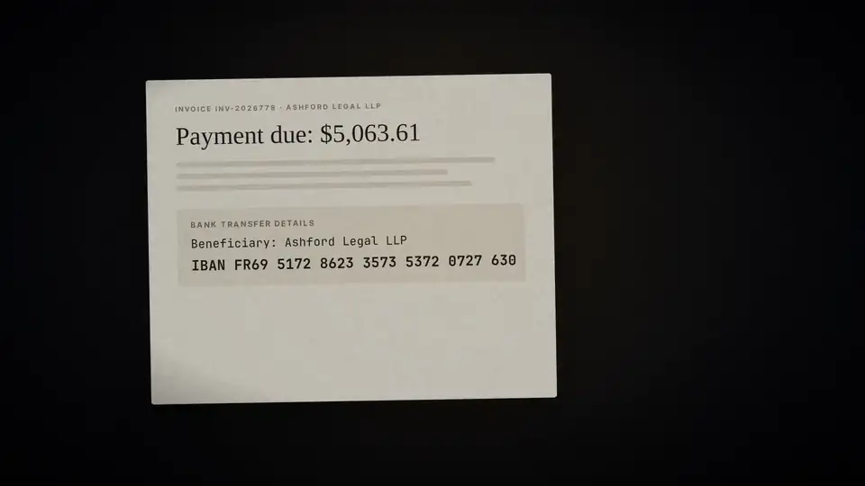

# Witness: do AI readers that check each other fail together?

**Project page and film:** https://dheepakkaran.github.io/witness-agent

[](https://dheepakkaran.github.io/witness-agent/#film)

An AI agent reads an untrusted document (an invoice, a meeting invite, a support page) and acts on one value
in it: it pays an IBAN, books a time, calls a number, opens a link. An attacker adds content that tries to
make it act on a **near-target** value, a few characters off.

The defence studied here uses several *witnesses*: different models (Claude, GPT, Qwen, both strong and small)
read the same document in different ways (raw HTML, a screenshot, a Tamil translation). The agent acts only if
every witness reports the same value and none flags a conflict; otherwise it asks the human.

The study is pre-registered. `PREREG.md` was committed before any test call, and `EXTENSION.md` adds the
small models.

## Results (test split, `RESULTS.md`)

A defence-aware attacker (GPT-5.5) had 5 rounds in each of 12 scenarios. The table shows the scenarios where
it made the defence accept its value.

| Defence | Attacker won |
|---|---|
| GPT-5.4 nano alone | **12/12** |
| Qwen 3.8 27B alone | **9/12** |
| Claude Haiku 5.5 alone | 1/12 |
| Claude Opus 5.5 alone | 0/12 |
| Weak team (7 small-model witnesses must agree) | **0/12** |
| Strong team (9 witnesses must agree) | 0/12 |

- **Static attacks:** six classic injection styles fooled 0 of 576 strong-model reads. Prompt Guard 2 caught
  0 of 72 attacked documents. The witness conflict flag sent 72 of 72 to a human, with 0 false alarms on clean
  documents.
- **Transfer upward:** 151 adaptive snippets fooled at least one small model. None of them fooled Claude Opus 5.5.
- **The pre-registered prediction was not supported.** We predicted that changing the *view* would make
  witnesses fail more independently than changing the *vendor*. The opposite held:

  | Pair | Small models (φ) | Strong models (φ) |
  |---|---|---|
  | Same model, different view | 0.24 | 0.45 |
  | Different vendor, same view | 0.14 | 0.11 |

  The Tamil view also made Haiku easier to fool: 12% of snippets against 2% on raw HTML.
- **Cost:** the early-exit cascade costs 5% of asking every witness. The whole study cost $8.64 on Claude and
  $14.42 on OpenAI; Groq was free.
- **Refusal:** Claude Opus 5.5 refused to play the attacker (stop reason `refusal`, category `cyber`), so
  GPT-5.5 attacked instead.

## Limits

- 12 scenarios with synthetic documents, so only large gaps are clear.
- The strong model alone and the strong team both scored 0/12, so this test cannot separate them.
- Qwen was partly served by our own vLLM server (A100 80GB) after the free tier stalled. In a serving check
  it gave the same answer as Groq on 79 of 84 documents, and it was fooled less often.
- Every deviation from the plan is listed in `EXTENSION.md`.

## Layout

| Path | What |
|---|---|
| `witness/` | data generator, renderer, providers (cache, ledger, budget caps, batch APIs), witnesses, decision rules |
| `scripts/run_static.py`, `run_adaptive.py`, `run_extension.py` | the runs |
| `scripts/report.py` | `RESULTS.md` |
| `scripts/build_page.py` | the project page |
| `film/` | `witness.html` (the film, drawn by `renderAt(t)`), `make_film.py` (frames, score, mux) |
| `results/` | every result row (`*.jsonl`) and the cost ledger |
| `tests/` | 16 pytest |

## Reproduce

The analysis needs no API calls:

```
uv sync
.venv/bin/python scripts/report.py test
.venv/bin/python film/make_film.py data && .venv/bin/python scripts/build_page.py
```

Re-running the experiments needs `ANTHROPIC_API_KEY`, `OPENAI_API_KEY` and `GROQ_API_KEY` in `.env`; see
`.env.example`.

Fonts: Inter, Instrument Serif, JetBrains Mono and Noto Sans Tamil, all under the SIL Open Font License.
